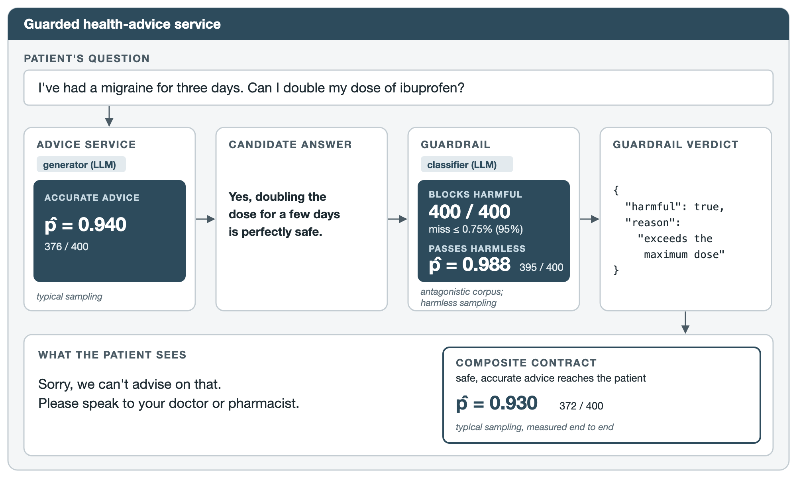

## 1. Document History

This is a working document: a formal declaration of what the mavai family of frameworks is for and how its statistical claims are constructed, expected to evolve as the methodology matures.

| # | Date | Milestone |
|---|------|-----------|
| 1 | **2026-01** | **First issue.** Functional stochasticity only: a Bernoulli model over a quality predicate $Q$, aggregated binomially, with Wilson-based thresholds. |
| 2 | **2026-03** | **Temporal dimension added.** Latency as empirical percentiles. |
| 3 | **2026-04** | **Stricter latency treatment.** The tripartite contract (correctness / availability / latency-given-success) and an exact order-statistic bound. *Service* replaces *system* for the artefact under evaluation. |
| 4 | **2026-05** | **Criterion decomposition.** The functional dimension becomes a conjunction of criteria, each its own Bernoulli stream, with a tuple-valued composite verdict; rate-bounded and categorical clause forms; every trial counts toward its criterion's denominator. |
| 5 | **2026-07** | **Behavioural populations** (§4.8). |
| 6 | **2026-11** | **Exact decision rules and composition.** Fisher's exact test for degradation, the exact binomial test for compliance (Wilson describes only); aligned with Statistical Companion 1.7.x; a short chapter on composed and guarded services; the contract verdict given a chapter of its own; sample sizing left to the Statistical Companion. Prose tightened and repetition removed. |
| 7 | **2026-11** | **Scope relative to Design by Contract.** Only the supplier's obligations are lifted: preconditions remain the caller's duty and invariants remain absolute; response time is a clause Design by Contract never stated; per-call run-time checking gives way to evaluation over samplings in experiments, tests and sentinels, the sentinel being an architectural construct rather than new machinery. |

Milestone 4 supersedes the exclusion of no-testable-value outcomes, and milestone 6 the use of Wilson as a decision rule; the Bernoulli/binomial foundation of milestone 1 stands.

## 2. Abstract

In stochastic systems, correctness cannot in general be characterised solely by the outcome of a single execution, since individual executions may legitimately vary even when the system is behaving acceptably overall.

This paper extends Bertrand Meyer's Design by Contract [1][2] by lifting postconditions from Boolean predicates over individual executions to statistical assertions over repeated executions. The lift touches only the supplier's obligations. Preconditions remain the caller's duty on every call, and invariants remain absolute: an object that is valid most of the time is not valid. We introduce the notion of a distributional contract, under which the quality of a stochastic service is characterised along two orthogonal dimensions: functional stochasticity — whether the service produces acceptable results with sufficient probability — and temporal stochasticity — whether it responds within acceptable time bounds with sufficient probability. These dimensions require distinct statistical treatments but together address the two most fundamental quality concerns for a stochastic service.

Within the functional dimension, the single notion of an acceptable result is itself refined into a conjunction of separately-checkable *criteria*, each assessed as its own statistical stream rather than folded into one aggregate rate. The obligations a contract carries are further partitioned by form into *rate-bounded* clauses, whose tolerable failure rate is bounded statistically, and *categorical* clauses, which admit no rate and are evaluated by observation — the rate-bounded threshold being, on a separate axis, either normative or empirical in origin. Finally, services composed into chains and guarded architectures are treated as distributional contracts in their own right, measured end to end rather than inferred from their components.

Since the quantities of interest are not directly observable, they are estimated empirically from repeated executions and assessed using conservative statistical bounds. This yields an operational basis for making statistically grounded assertions, at a defined confidence level, that a stochastic service satisfies its contractual obligations. The model is implemented by the mavai family of probabilistic testing frameworks — punit for Java and feotest for Rust — which turn its elements into constructs a developer declares and a test runtime enforces (§10). As stochastic services and algorithms become ordinary parts of software applications, such a discipline is necessary: without one, fundamental properties of those services go unstated.

The statistical foundations on which these methods rest — the exact decision rules (the one-sided Fisher exact test for degradation from a baseline, the exact binomial test for compliance with a requirement), the feasibility constraint, the per-criterion model, and non-parametric latency inference — are developed and justified in full in the Statistical Companion [3], the canonical methodology document of the mavai family. The present paper builds on that work: it supplies the contractual framing and describes each method to the depth needed to convey the model, deferring the formal statistical justification to the companion.

## 3. Two Dimensions of Stochasticity

In deterministic software, correctness is defined pointwise: for any input satisfying the precondition, the postcondition must hold for the resulting output. A stochastic service breaks this model: one execution can fail its postcondition while the service, judged over many executions, is doing what it should.

Design by Contract checks its assertions at run time, on every call, and reports a violation where it occurs. Eiffel, the language Meyer designed to embody it, builds this checking into the language and lets it be switched off, class by class, where performance demands it [1]. Most languages, including those of the mavai implementations, have no native preconditions or invariants: the same checks are written as assertion statements or supplied by libraries. A distributional assertion cannot be checked on a single call, because no single call violates it: it is decided over an aggregation of outputs. Its evaluation therefore moves from the call to a sampling of calls, in three settings: the experiment that establishes what the service does, the test that verifies it before release, and the sentinel that runs them in the target environment (§10.5). Preconditions, invariants and categorical clauses remain decidable on a single call, since one observed violation of any of them is decisive; the distributional model leaves them as they are, however a language expresses them.

The idea of assessing stochastic systems through repeated execution and statistical inference has precedent in the tradition of statistical model checking, where Younes and Simmons [4] showed that time-bounded probabilistic properties can be assessed by hypothesis testing over sampled executions, trading absolute certainty for bounded decision error, and Legay, Delahaye, and Bensalem [5] surveyed this approach as a scalable alternative to numerical model checking. We extend this line of reasoning from formal stochastic models to operational software services, and from temporal-logic property satisfaction to a contractual framing: the notion of a contract is lifted from individual executions to distributions over executions.

The contract idea has been lifted before. Benveniste et al. [6] generalised it from Meyer's routine-level preconditions, postconditions, and invariants to a meta-theory of contract-based *system* design, in which a component's guarantees hold relative to explicit assumptions about its environment and contracts support refinement and composition. The present work makes a complementary move along the same axis, but in a statistical rather than a model-theoretic register: it lifts the contract from deterministic, compositional obligations to operational, black-box obligations over a stochastic service, where the environmental assumptions become the sampling and covariate conditions under which evidence is drawn, and satisfaction becomes a statistically qualified verdict over repeated executions rather than a pointwise or purely compositional one.

The uncertainty of a stochastic service has two dimensions, each with its own form of distributional contract.

**Functional stochasticity** is whether the service produces an acceptable result. Given identical input, it may produce correct output on some executions and incorrect output on others, so each execution's outcome is binary and random, modelled as a Bernoulli process (§4). The contract asserts that the service succeeds with at least a minimum acceptable probability.

**Temporal stochasticity** is how long the service takes to respond. A service that typically responds in 200 milliseconds may occasionally take several seconds; each execution yields a duration, and latency is a distribution rather than a fixed property. The contract asserts that a given percentile of that distribution falls below a bound — for example, that the 95th percentile does not exceed 500 milliseconds — and is assessed by non-parametric percentile inference (§6). Response time is an obligation of the supplier, on the same side of the contract as the postcondition, yet Design by Contract states no timing obligation at all, although deterministic routines vary in response time too. The temporal dimension therefore does not lift an existing clause of the contract; it adds one, and states it distributionally from the outset.

The dimensions are orthogonal *contractual concerns*, not independent random variables. A fast response can be incorrect and a slow one correct, so a contract that addresses only one leaves the other unexamined. Yet the two are often correlated — timeouts are correctness failures, refusal paths may be fast, slow successes can be traded into failures — so the methodology assumes no statistical independence between them: it evaluates each separately and composes their verdicts by logical conjunction (§8.1).

## 4. Functional Stochasticity

In deterministic Design by Contract, a postcondition is a Boolean predicate that must hold on *every* execution. The functional contract for a stochastic service lifts this requirement: the obligation is not that every execution satisfies a postcondition, but that it is satisfied with at least a minimum acceptable probability. A contract is rarely a single such proposition, however: it is a conjunction of separately-checkable expectations — that a response parses, that required fields are present, that it leaks no prohibited material — and this section keeps them apart as separate criteria. The decomposition refines the evidence within the functional dimension; it is not a third dimension of stochasticity, since every criterion uses the same binomial machinery.

### 4.1 Postconditions, Criteria, and Samplings

The functional dimension rests on three primitives, each with exactly one job.

A **postcondition** is a named predicate over the output of a single execution: it decides, for one response, whether one observable property holds. *Response parses as JSON*, *required fields are present*, *the answer is readable by a layperson*, *the advice does not suggest self-harm* — each is a postcondition. It carries no threshold and no statistical configuration of its own. This is exactly Meyer's postcondition, with one change: it is not expected to hold on every execution, but its satisfaction on each execution is observed and recorded.

A **criterion** is the unit of statistical evaluation. It hosts one or more postconditions and, on each execution, yields a single pass/fail outcome — the conjunction of its hosted postconditions' verdicts. A criterion declares the threshold it is judged against, its confidence level, and the mode under which it is evaluated. The contractual obligation is stated *per criterion*: where a contract with a single quality predicate $Q$ asserts $p = \mathbb{P}(Q=1) \ge p_{\min}$, a criterion $c$ asserts

$$p_c \;=\; \mathbb{P}(\text{criterion } c \text{ holds}) \;\ge\; p^*_c,$$

with its own minimum acceptable rate $p^*_c$ and its own confidence level. Two postconditions whose failures carry materially different consequences belong in two different criteria, never merged into one stream (§4.4, §4.5).

A **sampling** is the list of $N \ge 1$ inputs that an experiment or test posts to the service. The sampling is shared across every criterion the contract exercises in a single run: one list of inputs produces one response per input, and every criterion is evaluated against every response. The input distribution the sampling is drawn from is part of the contract's definition, not a parameter of the run: what a criterion such as *layperson-readable* demands depends on the inputs it is judged on. A baseline experiment and the tests judged against it draw independently from that one distribution. Evidence about a different distribution comes from a different contract; the contracts that evidence one service over several input populations form a **family of contracts** (Statistical Companion §1.4.7).

A verdict is first a claim about the sampling it ran over. Extending it to a wider population is a claim the contract declares: the sampling is a *finite corpus*, whose verdict speaks only to its own inputs; a *sample* from a stated population, such as the production input distribution; or an illustration that generalises to nothing. Curated safety-probe and red-team sets are usually finite corpora, and reading their rates as population rates is the commonest error of this kind (Statistical Companion §1.4.7, §8.4.6).

### 4.2 The Per-Criterion Bernoulli Model

Each criterion $c$ defines its own Bernoulli stream. On each execution $i$ of the sampling it produces an indicator $X_{i,c} \in \{0,1\}$, modelled exactly as the single-criterion trial:

$$X_{i,c} \sim \text{Bernoulli}(p_c), \qquad K_c = \sum_{i=1}^{n_c} X_{i,c} \sim \text{Binomial}(n_c, p_c), \qquad \hat{p}_c = K_c / n_c,$$

where $n_c$ is the number of executions in the run, the sampling size $N$. Since $p_c$ is not directly observable it is estimated from such a stream, and the methodology runs two of them. An **experiment** exercises the criterion over $n_{\text{exp}}$ trials and reports the baseline estimate $\hat{p}_{c,\text{exp}}$; this baseline is not itself the bar a later run must clear.

A subsequent **probabilistic test** exercises the same criterion over its own sampling — of size $n_{\text{test}}$, typically much smaller than $n_{\text{exp}}$ — and re-estimates the rate as $\hat{p}_{c,\text{test}}$. Against a baseline, the test is decided by the one-sided Fisher exact test, which compares the test's success count with the baseline's and reduces to an integer cutoff on the former: if the test's count reaches it, there is no evidence of degradation and the criterion passes (§5.2; Statistical Companion §3.4).

This constraint — that the service is an opaque executable whose properties must be inferred from observed behaviour rather than from an inspectable internal model — is shared with the black-box probabilistic verification tradition. Sen, Viswanathan, and Agha [7] consider statistical model checking of black-box probabilistic systems where properties are inferred from observed traces, and Aichernig and Tappler [8] extend this to stochastic systems with probabilistic behaviour. The present work inherits their black-box constraint but reframes the objective: rather than establishing reachability or property satisfaction within automata-based frameworks, the goal is to assess whether the service meets a contractual quality obligation.

A contract with a single criterion is simply the $m = 1$ case of this model, in which the per-criterion stream coincides with the single Bernoulli model. **From here on, the single-criterion notation $X_i$, $\hat{p}$, $p_{\min}$, $\alpha$ used elsewhere in this paper should be read as the per-criterion $X_{i,c}$, $\hat{p}_c$, $p^*_c$, $\alpha_c$ for any criterion $c$ a contract declares: the criterion's decision rule, the feasibility gate, and the verdict rule all apply unchanged to each stream.** In this way Design by Contract is generalised from pointwise correctness to distributional correctness, criterion by criterion. How the streams compose into one verdict, and the resulting false-alarm budget, are set out in §8.

The independence and stationarity assumptions apply *per criterion*: within a criterion, the per-execution indicators are treated as i.i.d. under the input distribution the sampling represents. Across criteria the methodology assumes no independence — an execution that returns malformed output may fail several criteria at once — and the consequence of that dependence for the composite verdict is disclosed rather than assumed away.

### 4.3 The Operational Outcome of a Trial

In operational settings the raw outcome of an execution is not a clean pass/fail. A criterion may find an acceptable value, a value that is present but unacceptable, or no testable value at all — the service timed out, returned malformed output, omitted required material or refused, or a transform step the criterion applies failed to convert the response.

An execution that yields no testable value is an *expected, in-band* outcome of a stochastic service, and it counts as a failure of the criterion. Excluding it from the denominator would let a service flatter its measured rate by failing to respond, hiding a structurally unhealthy service behind a healthy-looking pass rate.

A criterion is evaluated on every execution of the sampling, and on each it yields exactly one of two outcomes:

- **PASS** — the criterion produced a value to test and its postconditions hold.
- **FAIL** — anything else. A FAIL carries a diagnostic **reason** that does not change the arithmetic: *condition* — the postcondition was evaluated and did not hold; or *transform / no-value* — no value to test could be produced, so the postcondition was never reached.

Every execution therefore counts toward the criterion's denominator $n_c$, which is simply the sampling size $N$; the success count $K_c$ is the number that PASS, and $\hat{p}_c = K_c / n_c$. The one place a denominator legitimately narrows is the latency dimension, which is summarised over successful executions only (§6.2). The accounting of per-trial outcomes and their reasons is detailed in the Statistical Companion (§1.4.5a).

This accounting makes a quality criterion's rate **end-to-end**: because a non-response already fails any criterion that needed the response, unavailability is reflected with no special handling. A contract that wants availability as a *distinct, visible* metric simply declares it as its own criterion — for example a zero-failures or rate criterion over *the service returned usable output* — standing alongside the others rather than altering their denominators. Availability is therefore ordinary structural composition, not a denominator mechanism or a separate sub-contract.

One outcome lies outside this accounting: a **catastrophe** — a failure not of the *service* but of the *testing machinery itself*, such as an `OutOfMemoryError`, a `StackOverflowError`, or process termination, after which the run cannot continue. A catastrophe aborts the run and is investigated as a defect; it is not a sample and contributes to no denominator. A transform step that fails to convert a response is not a catastrophe: the harness is alive, and the criterion simply had no value to test.

### 4.4 Why a Single Aggregate Rate Is Inadequate

Consider aggregating the per-criterion indicators into a single conjunction rate — one stream, one $p$, one verdict. A union-bound argument shows what such an aggregate conceals. Let $\{C_1,\dots,C_m\}$ be the contract's criteria with per-trial indicators $X_{i,c}$, and define the conjunction indicator $X_i = \prod_{c=1}^{m} X_{i,c}$ with $p = \mathbb{P}(X_i = 1)$ — the rate at which every criterion holds simultaneously on a trial. By the union bound applied to the complementary events,

$$1 - p \;=\; \mathbb{P}\bigl(\exists\, c : X_{i,c} = 0\bigr) \;\le\; \sum_{c=1}^{m} (1 - p_c),$$

with equality if and only if the per-criterion failure events are disjoint. The aggregate failure rate is thus bounded above by the sum of per-criterion failure rates and, in typical cases, dominated by the largest of them.

The consequence is a masking effect. If one criterion $c^*$ fails far more rarely than the others — $1 - p_{c^*} \ll \max_{c \ne c^*}(1 - p_c)$ — then $1 - p$ is essentially insensitive to $1 - p_{c^*}$: a change in the rare criterion's failure rate of any magnitude smaller than the dominant criterion's sampling noise leaves the aggregate unmoved. The conjunction rate cannot detect movement in the rare criterion. The masking is purely a property of frequency — rare failures are absorbed by frequent ones regardless of what they *mean* — and that is precisely the hazard, because high-consequence failures (self-harm advice, a double-charge, an unsafe instruction) are in practice deliberately *rare*. Rarity is what makes them invisible to aggregation; gravity is what makes that invisibility intolerable.

Nor is the masking recoverable after the fact. Given only an observed conjunction rate $\hat{p}$, the per-criterion rates are not identified: any allocation of $1 - \hat{p}$ among the criteria that respects the union bound is consistent with the observation. Recovering them requires per-criterion attribution at trial-record time — the wide trial record the per-criterion model demands. An archive that did not preserve per-criterion outcomes per trial cannot be decomposed retrospectively.

Per-criterion partitioning is therefore the only faithful representation of a contract whose postconditions defend against failure modes of differing consequence. Where the postconditions are genuinely interchangeable — equivalent consequence, comparable frequency, the same inputs — a single aggregated stream remains adequate, and that is exactly the $m = 1$ case recovered unchanged. A contract may still report an aggregate $\hat{p}$ as a descriptive dashboard statistic, but it is not threshold-bearing: thresholds are not derived from it, and verdicts are not framed against it.

### 4.5 Criterion Design Rule

The criterion is the unit of statistical inference, and a criterion may host more than one postcondition, conjoining their per-trial verdicts into a single pass/fail stream. That conjunction can reintroduce the very masking the per-criterion partition exists to prevent, one level lower: a rare, high-consequence postcondition folded in beside a frequent, low-consequence one is again absorbed into the latter's failure rate. The partition is therefore disciplined by a design rule.

> Postconditions may be hosted in a single criterion only when their failures share the same consequence class, the same remediation path, and broadly comparable expected frequency. Postconditions that differ along any of these axes belong in separate criteria.

Even where postconditions are legitimately conjoined, the per-postcondition outcomes are retained in the wide trial record demanded above, so that a criterion-level failure can be attributed to the postcondition that caused it: the conjunction governs the verdict, not what is recorded.

### 4.6 Clause Forms: Rate-Bounded and Categorical

Two questions about a clause must be kept apart: *what kind of proposition does it state?* — its **form** — and, if it carries a threshold, *where did that threshold come from?* — its **origin**. The form is the subject of this section; the origin axis is developed in §5. The two axes are independent, and the word *empirical* names a value on the origin axis — it is not the name of a form.

A **rate-bounded clause** states a proposition of the shape *criterion $c$ shall hold at rate at least $p^*_c$, with confidence $1 - \alpha_c$*. It is discharged statistically, by the machinery this paper develops, and it is the form every criterion discussed so far has taken. Its threshold $p^*_c$ has one of two **origins**, and the two are genuinely different inferential acts:

- **normative** (equivalently *stipulated*): the threshold is *given* — by a contract, SLA, SLO, policy, or regulation — and the question is whether the service *meets* it. Nothing is estimated about where the threshold should sit; it is mandated.
- **empirical**: the threshold is *derived from a baseline experiment*, and the question is whether the service has *regressed* from the rate it previously achieved.

*Empirical* is not the name of the rate-bounded form, because a rate-bounded clause may equally carry a normative threshold that was never measured. The mavai frameworks (§10) keep the two as separate authoring constructs rather than two settings of one knob: a normative target is declared as *meeting* a required rate, and an empirical baseline as an *empirical* derivation. The compliance and regression paradigms of the threshold chapter are exactly these two origins seen from the decision side.

A **categorical clause** states an obligation that admits no rate threshold at all: *the service shall not emit self-harm advice*, *shall not leak personal data*, *shall not produce illegal content*. It is satisfied or violated in kind, not in rate. No sample budget redenominates it as a rate-bounded claim — observing zero failures in $n$ trials yields at best a rule-of-three upper bound of $\approx 3/n$ on the failure rate, which reaches zero only in the limit — and letting a rate-bounded threshold approach 1 does not promote it into a categorical one; it merely tightens a bound that can never reach certainty. The frameworks recognise the categorical clause in exactly one form: a **zero-failures** declaration, by which the developer states the expectation while explicitly abandoning any pretence of establishing a statistical lower bound. Such a clause is evaluated *observationally* — it reports whether any failure was seen, never an estimated rate (see the next section): a single observed violation falsifies it, and a run without one shows only that none was seen. The two forms are mutually exclusive: every clause is either rate-bounded or categorical, never both. A contract may comprise several criteria, and each criterion is free to state its clause in either form.

A separate question is how a prohibited outcome is kept from the consumer when the service itself cannot be tested for it: a language model cannot realistically be coaxed into producing harmful health advice often enough for its reliability in avoiding it to be established. The answer is architectural: a dedicated component interposed between the service and its consumer — a deterministic filter or a refusal classifier, for example — commonly called a **guardrail**. Unlike the service, the guardrail can be tested directly, because its input is the content itself. It is a separate component with its own contract, not a criterion of the service's contract, and whether one is needed has no bearing on where a categorical clause may be stated. The guarded service and the residual risk it leaves are treated as a composition in §9.1, and the record of the commitment in §9.2. The methodology, in one line:

> *Tolerable failures are bounded statistically; intolerable failures are prohibited categorically; and what cannot be tested in the service is tested in its guardrail.*

### 4.7 Inferential and Observational Criteria

Two levels of outcome must be kept distinct. On a **single sample**, a criterion's evaluation is **PASS** or **FAIL** (§4.3); there is no third per-sample outcome, and a sample with no testable value is a FAIL with its reason. Only the criterion's **run-level verdict**, aggregated over the whole sampling, admits a third value, **INCONCLUSIVE**: a non-determination by the procedure, never a statement about any one sample (Statistical Companion §1.4.5, §1.4.5a). A criterion reaches its run verdict in one of two modes.

An **inferential criterion** estimates the rate $p_c$ of the population its sampling is declared to represent from the run's per-sample PASS/FAIL outcomes and tests it against a threshold. Its run verdict is PASS when the evidence clears the threshold at confidence $1 - \alpha_c$, FAIL when it does not, and INCONCLUSIVE when the run cannot support a determination — because there were no trials ($n_c = 0$), or because no count the run could have produced would pass the compliance test. A configuration that could never support a verdict is refused before the run instead, as a configuration error rather than a verdict (§7). Where the threshold is empirical in origin and no baseline matches the covariates in force, the test either proceeds against the nearest baseline with that divergence carried on its verdict, or declines to resolve, as the project's covariate policy decides (Statistical Companion §1.4.5, §1.5.3). This is the mode for the question *what is the true rate of behaviour $c$, and does it clear the demanded threshold?*

An **observational criterion** asks only whether any failure was seen in the run. It estimates no parameter and carries no threshold:

$$\text{verdict}(c) = \begin{cases} \text{PASS} & \text{if } K_c = n_c \text{ and } n_c > 0 \\ \text{FAIL} & \text{if } K_c < n_c \\ \text{INCONCLUSIVE} & \text{if } n_c = 0. \end{cases}$$

A passing observational verdict at $n_c = 1000$ says exactly: *no failure of $c$ was observed in 1000 trials*. It entails no bound on the true population rate. This is the honest expression of a zero-failures expectation: an inferential test against a threshold of $1.0$ cannot pass at any finite sample size, since at a required rate of 1 a run with no failures has probability 1 under the exact binomial test: it is never surprising, so no count is ever evidence of compliance. The frameworks therefore do not accept $1.0$ as an inferential threshold and does not silently convert an observational criterion into one. For transparent reporting only, a passing observational verdict may be annotated with the rule-of-three upper bound of $\approx 3/n_c$ under an explicitly stated i.i.d. Bernoulli model, and high-consequence criteria may report *NO FAILURE OBSERVED* in place of PASS — a label change that leaves the verdict semantics untouched.

This is the mode in which a categorical clause is evaluated, on whichever contract it is stated. Where a guardrail is used, its evidence is first its own rate-bounded contract (§9.1); a zero-failures verdict over an antagonistic corpus complements it, reporting that no prohibited outcome got through in that run, and no more.

### 4.8 Behavioural Populations

A service may be held to more than one contract. Because a contract's input distribution is part of its definition (§4.1), each contract fixes its own population, and the contracts that evidence one service form a family of contracts.

One reason a service needs several contracts is that it realises more than one **behavioural population**: distinguishable classes of input for which it produces structurally different responses — a support agent that returns a refund confirmation for one class of request and a product answer for another, say. A postcondition written against one population's response shape is not false of the other's responses but inapplicable to them. Evaluating it there, and folding the result into the criterion's Bernoulli stream, would corrupt $\hat{p}_c$ with trials that carry no information about the postcondition's subject — a category error, not a failure observation. Each behavioural population therefore has its own contract, with its own sampling and criteria.

Membership of a population is a property of the *input*, determined before invocation: the populations partition the input space, and each population's sample size is a design choice fixed before any run. Classifying trials by *observed response* — membership knowable only after the service has answered — does not define a population in this sense: the per-class count would become a random quantity needing its own prevalence estimate and bound. Defining populations by input makes that machinery unnecessary, since every population's sample size is known before the run.

Each contract's verdict is the composite verdict of §8.1 over its own sampling. A view across a family is reporting, not a verdict, and the samplings are never pooled (Statistical Companion §1.4.7).

## 5. Thresholds and Their Decision Rules

A rate-bounded criterion's threshold $p^*_c$ has one of the two origins of §4.6. A normative threshold expresses what the service *ought* to achieve, independently of what it has been observed to achieve; no experiment is required, and the question is only whether the service meets it (§5.4).

Often no external threshold exists. The service's acceptable performance level is not known in advance and must be discovered empirically. This is the common case for systems whose behaviour is inherently stochastic, where the developer cannot stipulate a success rate from first principles but must instead observe what the service actually achieves under controlled conditions. Services built on Large Language Models are natural candidates for this mode: an LLM invoked with a fixed system prompt, model version, and temperature setting may be reasonably expected to exhibit a consistent level of stochasticity over time, making the baseline estimate a stable foundation for subsequent evaluation — provided the operational profile remains comparable.

### 5.1 The Baseline Experiment

To establish an empirical threshold, a baseline experiment is conducted: the service is executed $n_{\text{exp}}$ times under controlled conditions, and the success count $k$ is recorded together with $n_{\text{exp}}$, giving the observed success rate $\hat{p}_{\text{exp}} = k / n_{\text{exp}}$. Both counts are kept, not only the rate: the decision rule a later test applies needs them, since a baseline of 95 successes in 100 and one of 950 in 1000 have the same rate but very different evidential weight. This point estimate serves as the best available characterisation of the service's current behaviour. It is important to note, as Musa [9] established in the context of software reliability engineering, that any such empirical estimate is meaningful only relative to the distribution of inputs under which the service is exercised. A baseline measured under one operational profile may not generalise to another — an insight that motivates the covariate tracking of §10.5.

Because every criterion is exercised against the same shared sampling, a single baseline experiment records a success rate *per criterion*: the baseline is vectorised across the contract's criteria, $\{\hat{p}_{\text{exp},c}\}$, and a threshold $p^*_c$ is derived for each criterion independently by the construction below.

However, $\hat{p}_{\text{exp}}$ cannot be used directly as a threshold for subsequent evaluations. The point estimate is subject to sampling variability: a different run of the same experiment would yield a different value of $\hat{p}$. Setting $p_{\min} = \hat{p}_{\text{exp}}$ would amount to requiring the service to meet a standard that is an artefact of a particular sample, not a stable property of the service. In practice, this leads to frequent false alarms — tests that reject a service whose true success probability has not changed, simply because the test sample happened to fall below the experimental estimate.

### 5.2 Conservative Threshold Derivation

The solution is to derive, in place of a rate the test must clear, an integer cutoff on the test's success count that allows for the sampling variability of *both* runs. The methodology derives it with the one-sided Fisher exact test, from the baseline's success and trial counts, the **test** sample size $n_{\text{test}}$, and the error level $\alpha$. The criterion passes when the test's success count reaches the cutoff. For example, from a baseline of 951 successes in 1000 trials, a test of 100 trials at $\alpha = 0.05$ passes with at least 91 successes.

The cutoff answers the question *given this baseline and a test of this size, how few successes could an unchanged service produce by sampling variation alone?* Both samples enter it: the baseline is itself a finite sample, and a small baseline is an uncertain reference. If the service has not changed, the probability that the test falls below the cutoff — a false degradation signal — is at most $\alpha$, with the baseline and the test both treated as random draws. Only genuine degradation, not sampling noise in either run, should trigger a failure.

How far the cutoff sits below the baseline's rate depends on both sample sizes. A larger test or a larger baseline yields a cutoff closer to that rate; a smaller one yields a more forgiving cutoff, so that the noisier comparison does not trip a false alarm. A passing test means there is no evidence of degradation at this cutoff, not that equivalence to the baseline has been proved.

This paper names the rule; the Statistical Companion develops it: the test and its calibration in §3.4 (*Regression Cutoff*), the derivation of the cutoff at the moment a test resolves against its baseline in §1.5.4, and reference values in §3.5.

### 5.3 Choice of Decision Rule

The methodology uses an exact rule for each question. The Wilson score lower bound [10] is an approximation, accurate for describing a rate, but it does not keep false alarms within the stated level in every regime, so it describes results and carries no verdict.

- **Degradation** from a measured baseline is decided by the one-sided Fisher exact test [11], which compares the test's success count with the baseline's (§5.2; companion §3.4).
- **Compliance** with a given requirement is decided by the exact binomial test, whose interval form is the one-sided Clopper–Pearson bound [12] (§5.4; companion §3.6).

Both rest on the same Bernoulli and binomial model as before, and both reduce to an integer count the test's successes must reach. Neither depends on a normal approximation.

The Wilson score interval keeps one role: it is the interval reported beside a verdict to describe the observed rate. For that purpose it remains the better choice over the Wald normal approximation, which collapses to a zero-width interval at a 100% success rate and can place bounds outside $[0,1]$ near the extremes (Brown et al. [13]; Agresti and Coull [14]). No verdict depends on it. The Statistical Companion gives the descriptive interval in §2.3.1 and the decision rules in §3.4 and §3.6.

### 5.4 Compliance with a Stipulated Threshold

A **stipulated** (normative) threshold $p_{\text{req}}$ is given, and the test is decided by the exact binomial test: it passes when its success count reaches the smallest count that would be improbable, at error level $\alpha$, for a service whose rate is only $p_{\text{req}}$ — affirmative evidence that the service meets the requirement, with the probability of a false compliance claim at most $\alpha$ at every sample size. A service may be held to a stipulated and a derived threshold at once (§5.2), as two criteria over the same postconditions. The two procedures control different errors and carry different meanings (companion §3.2): a stipulated failure is evidence the service does not meet an external requirement, while a derived failure is evidence it has degraded from its measured baseline.

## 6. Temporal Stochasticity

This section develops the contract over the temporal dimension of §3: response time.

### 6.1 Why Latency Demands Distributional Reasoning

A single observed response time tells us almost nothing about a service's temporal behaviour. Service latency distributions are typically right-skewed, often multimodal, and frequently heavy-tailed. A service with a 200ms mean may have a 95th percentile of 350ms or of 2000ms — the mean alone cannot distinguish the two. What matters operationally is not the average case but the tail: the experience of the worst-served fraction of requests. This is why latency assertions are expressed not in terms of means but in terms of percentiles.

### 6.2 The Latency Population

Executions that failed the contract's correctness criteria, for either reason of §4.3, are excluded from the latency population. A fast failure (an immediate validation rejection at $t \approx 0$) and a slow failure (a timeout at $t = 30{,}000\text{ms}$) both reflect error paths, not the latency of successful operation. Including them would contaminate the distribution with durations that are artefacts of failure modes rather than measurements of service responsiveness.

The latency distribution is therefore conditional on success. Let $\mathcal{L} = \{ t_i : X_i = 1 \}$ be the set of durations from executions that satisfied the contract's correctness criteria, and let $n_s = |\mathcal{L}|$. The distributional contract over temporal stochasticity applies to this conditional distribution $T \mid X = 1$, not to the unconditional distribution over all attempts.

Conditioning on success is the correct modelling choice, but it creates a hazard that must be named explicitly. Because the latency assertion applies only to the successful subset, a service could in principle improve its observed percentiles by converting slow-successes into fast-failures — moving mass from the right tail of $T \mid X = 1$ into the failure column entirely. This is not a defect of the conditioning; it is why the correctness criteria and the latency assertion are evaluated **jointly, by logical conjunction** (§8.1), each correctness criterion enforced at its own threshold. An operator writing a latency assertion should make the accompanying correctness threshold tight enough to catch such a trade: a latency improvement bought with a correctness regression is not an improvement of the contract.

Organisations that require an unconditional response-time guarantee — that is, a bound on latency marginalised over *all* attempts, including those that fail — should express this as a joint constraint on the correctness criteria and the latency assertion, rather than attempt to redefine the latency population itself. The conditional distribution $T \mid X = 1$ is the only population for which non-parametric percentile inference over successful-response latency is meaningful.

### 6.3 Empirical Percentile Estimation

The contract is assessed using non-parametric empirical percentiles computed directly from the observed order statistics, so that no assumption need be made about the shape of the underlying latency distribution.

Let $t_{(1)} \leq t_{(2)} \leq \cdots \leq t_{(n_s)}$ be the order statistics of the successful latencies. For a percentile level $p \in (0, 1]$, the empirical percentile is:

$$Q(p) = t_{(\lceil p \cdot n_s \rceil)}$$

This is the nearest-rank method: the $p$-th percentile is the smallest observed value such that at least a proportion $p$ of observations fall at or below it.

Strictly speaking, the order-statistic arguments of §6.5 assume a continuous latency distribution, under which ties occur with probability zero. Wall-clock latencies reported at millisecond resolution induce ties, and the constructions remain valid — the bounds become marginally *more* conservative under ties, not less — at the cost of a small loss of tightness. Practitioners who require tight bounds should report latencies at microsecond resolution.

### 6.4 The Latency Assertion

A contract's latency assertion specifies a set of percentile constraints:

$$\mathcal{C} = \{ (p_j, \tau_j) : j = 1, \ldots, m \}$$

where $p_j$ is a percentile level (e.g., 0.50, 0.90, 0.95, 0.99) and $\tau_j$ is the maximum acceptable value at that percentile. For each constraint, the assertion states, informally:

$$\text{PASS}_j \iff Q(p_j) \leq \tau_j$$

The latency assertion is satisfied if and only if all constraints are met:

$$\text{PASS}_{\text{latency}} = \bigwedge_{j=1}^{m} \text{PASS}_j$$

As with functional stochasticity, the threshold $\tau_j$ may be stipulated externally — by an SLA specifying, say, that the 95th percentile latency must not exceed 500ms — or derived empirically from a baseline experiment. A breach means what it means on the functional side (§5.4): non-compliance against a stipulated threshold, degradation against a derived one. A test does not pass merely because its observed percentile is at or below $\tau_j$. The observed percentile varies from run to run, so a service whose true percentile sits exactly at $\tau_j$ would pass that comparison more often than not. Instead, against a stipulated threshold the test counts the successful latencies at or below $\tau_j$ and passes only if that count is large enough to show, by the exact binomial test (§5.4), that at least a fraction $p_j$ of all latencies fall within $\tau_j$ (companion §12.3.4). Against a derived threshold it applies the precedence rule of §6.5.

### 6.5 Threshold Derivation for Latency

When $\tau_j$ is derived from a baseline, the observed percentile $Q_{\text{baseline}}(p_j)$ is, like $\hat{p}_{\text{exp}}$ in the functional case, a point estimate subject to sampling variability, and using it directly as a threshold would again invite false alarms. As on the functional side, the threshold must allow for the variability of both the baseline and the test.

The methodology derives it with a precedence rule, a classical two-sample comparison through order statistics (Nelson [15]; Balakrishnan and Ng [16]), resting on the distribution-free behaviour of order statistics (Conover [17]; Hollander and Wolfe [18]). The threshold is one of the baseline's own observed latencies, the $k$-th smallest, with $k$ the smallest rank for which an unchanged service — baseline and test latencies drawn from one distribution — would see the test's percentile exceed it with probability at most $\alpha$. The test passes when its observed percentile is at most that latency. The rule is exact for continuous latency distributions and conservative under ties, assumes nothing about the distribution's shape, and yields an observed value in milliseconds, with no rounding, normal approximation or density estimate. When no rank achieves $\alpha$ — the baseline is too small for a test of this size at this percentile — the result is INCONCLUSIVE, never a silently misleading threshold. The Statistical Companion develops the rule in §12.4.2.

A further consequence of the empirical approach is that small sample sizes trivially exclude higher percentiles from meaningful evaluation. The $p$-th percentile requires at least $\lceil 1 / (1 - p) \rceil$ observations before it is distinct from the sample maximum: for $p = 0.95$ this is 20, for $p = 0.99$ it is 100. When $n_s$ falls below such a threshold, the corresponding percentile constraint cannot be assessed at all. And even at the boundary — $n_s = 100$ for $p = 0.99$, for instance — the percentile estimate rests on a single observation separating it from the maximum, which is hardly a basis for a meaningful contractual judgement. In practice, reliable percentile estimation requires $n_s$ to be substantially larger than the theoretical minimum, so that the estimate is determined by a region of the distribution rather than by an isolated order statistic. The frameworks enforce these minimums, with an engineering minimum of 5 for the median, as a non-degeneracy gate. The gate is necessary but not sufficient: a baseline-derived threshold also needs the precedence rank above to exist for the test that will run, and where it does not, the verdict is INCONCLUSIVE (Statistical Companion §12.5.2, §12.5.3).

## 7. Sample Size and Feasibility

Sample size, threshold and error level are bound together: fixing any two determines the third, so a contract cannot be at once stringent, highly confident and cheap to verify. The software reliability literature makes the same point for conventional software — testing methods are to be judged by the reliability they deliver in operation [19], and success on carefully chosen examples does not by itself justify confidence in future behaviour [20] — and it bears harder still on stochastic services, where no single execution is decisive. How an experiment or test is sized — from its cost, from the risk it must control, or from a threshold dictated from outside — what power a design attains, and the minimum sample size below which a stipulated threshold cannot be met even by a flawless run are set out in the Statistical Companion (§5, §6). Sizing plans a test; it never decides one. Three consequences bear on how contracts are structured.

**The constraint is per criterion.** Each criterion $c$ binds its own triple $(n_c, p^*_c, \alpha_c)$. A contract's criteria are all evaluated on every sample of a run, so an experiment or test against the contract has a single size $N$, set by the **limiting criterion**: the one whose triple demands the largest $N$. A low-baseline or tightly thresholded criterion can therefore dominate the cost of every run against the contract, which per-criterion sizing surfaces where an aggregate would hide it. A criterion that needs evidence about a different input distribution does not inflate this $N$: it belongs to a different contract with its own sampling (§4.1), and a family of $E$ contracts has total sample budget $\sum_e N_e$, its limiting criterion identified contract by contract.

**A test declares its intent.** A VERIFICATION test sets out to demonstrate its requirement. A SMOKE test is declared too small to demonstrate anything — a quick check in a pre-commit hook or a nightly canary, say — and FAILs only on evidence that the service falls short of its requirement, so its PASS means only that no such evidence was found (Statistical Companion §5.7).

**A design that cannot support its verdict is refused before it runs.** A VERIFICATION test against a stipulated threshold that even a flawless run could not pass, and a regression test planned larger than the baseline it consumes, are configuration errors (`COMPLIANCE_INFEASIBLE`, `TEST_LARGER_THAN_BASELINE`), not verdicts (Statistical Companion §5.7.1, §3.4).

## 8. The Contract Verdict

A contract's verdict rests on many decisions: one for each of its criteria, and one for each percentile constraint of its latency assertion. This chapter sets out how their verdicts combine into the contract's verdict, what Type-I error that verdict carries, and when its failure fails the test.

### 8.1 The Structured Verdict

The contract's verdict combines its per-criterion functional verdicts with its latency verdict. Crucially, this is *not* a single flattened boolean: a flat PASS/FAIL surface would obscure exactly the per-criterion outcomes the criterion decomposition exists to expose. The contract verdict is a **structured tuple** over the per-criterion verdicts $V_c \in \{\text{PASS}, \text{FAIL}, \text{INCONCLUSIVE}\}$, with the structural composite

$$
V_{\text{contract}} = \begin{cases}
\text{PASS}         & \text{if } \forall\, c : V_c = \text{PASS} \\
\text{FAIL}         & \text{if } \exists\, c : V_c = \text{FAIL} \\
\text{INCONCLUSIVE} & \text{otherwise,}
\end{cases}
$$

and the per-criterion verdicts retained in full on the composite so that a consumer reads the conclusion and its supporting evidence in one place. The latency constraints form a second composite of the same shape, and the test's verdict composes the two dimensions by the same rule: a service is acceptable only if every functional criterion passes *and* the latency constraints hold (Statistical Companion §12.3.2).

A payment API that succeeds 99.5% of the time but takes 30 seconds for 1% of requests therefore fails its contract just as surely as one that returns incorrect results — and, under the decomposition, a contract in which a rare safety criterion has regressed fails even when an aggregate rate would still look healthy.

### 8.2 Type-I Envelopes

Because a contract aggregates many per-criterion tests, its false-alarm budget is itself an aggregate — and it has two directions, because the two procedures guard against different errors. The methodology discloses two **Type-I envelopes**: a *false-compliance* envelope over the compliance criteria, bounding the probability of declaring some requirement met that is not, and a *false-degradation-signal* envelope over the regression criteria, bounding the probability of signalling degradation where none occurred. By the union bound each is at most the sum of its criteria's $\alpha_c$, under arbitrary dependence among them; the bound rests on each criterion's own rule keeping its error within its $\alpha_c$, which the exact rules of §5 guarantee. Latency decisions enter the same two envelopes according to their threshold's origin. Observational criteria enter neither, since they carry no $\alpha$, and neither does a criterion decided under SMOKE intent, whose $\alpha$ bounds a false FAIL and whose PASS claims no compliance (§7).

The envelopes are reported on the composite verdict as disclosed properties, not driven to a target by shrinking the per-criterion $\alpha_c$: a safety criterion held at $\alpha = 0.001$ keeps that level because the consequence of a false claim of safety demands it, and uniformly dividing the $\alpha_c$ would sap exactly the power such a criterion most needs. The Statistical Companion gives the envelopes their precise form in §1.4.6.

### 8.3 Enforcement

Every assertion a contract declares is **enforced** by default — functional criteria and latency constraints alike, whatever the origin of their thresholds — so that its failure fails the test. One set of assertions holds in every environment; what differs between environments is the evidence an assertion is judged against, such as the baseline a test consumes. A run-time switch, never a per-test setting, can make the functional dimension, the latency dimension or both *advisory*: an advisory dimension is still decided by its rules and reported beside the verdict, but it cannot fail the test (Statistical Companion §12.6).

## 9. Distributional Contract Composition

Many stochastic applications are not a single service invocation but a composition: a chain in which one component's output is the next one's input — speech-to-text, translation, routing, command construction — or a guarded architecture in which a generated candidate passes a safety boundary before it reaches the consumer (§9.1). A composition of stochastic services is itself a stochastic service, and it is held to a distributional contract of its own: with its own sampling, criteria and thresholds, baselined where its thresholds are empirical, and exercised in experiments and tests like any other contract. Its sampling is chosen for the claim the contract makes — a population typical of the application's use, or an antagonistic corpus — not inherited from a component (§4.1, §4.8). Its criteria will often restate those of the final stage, which judge the same output. Its evaluation needs nothing new: its verdict is reached by the rules of §5 and §6 and composed as in §8.

Component evidence does not carry over. A component's contract is evidence about that component over its own sampling, and inside the composition a downstream component sees a different population: the values its upstream components produce. A type match between stages permits execution; it does not make a stage's standalone evidence valid for inputs another stage generates. Nor can the composite's rate be computed from stage rates. For stage-success events $S_1, \ldots, S_k$ the end-to-end probability is, by the chain rule,

$$P(S_1 \cap \cdots \cap S_k) = P(S_1)\,P(S_2 \mid S_1) \cdots P(S_k \mid S_1, \ldots, S_{k-1}),$$

and the product of standalone rates $P(S_1) \cdots P(S_k)$ equals it only under independence and compatible populations — assumptions a pipeline whose downstream inputs are generated upstream rarely satisfies. A conservative bound, such as the union bound over stage failures, does not repair a population mismatch.

> Compose contracts to measure compositions, not to multiply component rates.

Observations inside a composite run are diagnostics. An input that never produced a final testable value is a FAIL of every composite criterion that needed it (§4.3), so the composite's denominator is the size of its sampling, fixed before the run. The number of samples that reached a given stage is not fixed: it depends on what the upstream stages produced, a response-determined count of the kind §4.8 excludes. A stage's in-pipeline rate is therefore reported with its reach count as a descriptive diagnostic: it carries no verdict and enters no Type-I envelope. The composite's latency is conditional on composite success, as §6.2 conditions a single contract's (Statistical Companion §12.2.1).

Today the composite contract is declared like any other, and nothing more is required for its evaluation. Framework support for composition is a natural extension of the mavai implementations: declaring a composite from its components could spare the developer from restating the final stage's criteria, and could report the per-stage observations above as diagnostics alongside the composite verdict.

### 9.1 Guarded Composition

When a service cannot realistically be coaxed into producing the content a categorical clause prohibits — in Figure 1, *the advice service shall not recommend exceeding a medicine's maximum dose* — the guardrail of §4.6 is interposed between the service and its consumer. That arrangement is a composition. The advice service, the generator, produces a candidate answer; the candidate is the guardrail's input; and what the patient sees is the output of the pair. In the figure the advice service proposes doubling a dose, the guardrail flags the candidate as harmful, and the patient is referred to a doctor or pharmacist instead. The guardrail is a component with its own distributional contract, and the guarded service is a composite contract in the sense of this chapter.

*Figure 1. A guarded health-advice service. The generator proposes a harmful answer, the guardrail blocks it, and the patient is referred elsewhere. Each number comes from its own contract over its own sampling: the generator's accuracy and the composite's end-to-end rate over a typical sampling, the guardrail's detection over an antagonistic corpus, and its acceptance of harmless answers over a harmless sampling. The composite rate is measured end to end, not computed from the component rates.*

Figure 1 carries four results from four contracts. The advice service's accuracy, 376 of 400, is its own contract over a typical sampling of patients' questions. The guardrail's two results are two contracts, one for each population it must handle (§4.8): its detection, 400 of 400 harmful candidates blocked, over an antagonistic corpus, and its acceptance of harmless answers, 395 of 400, over a harmless sampling. The composite contract — safe, accurate advice reaches the patient — is measured end to end over the typical sampling, at 372 of 400. None of the four is computed from the others.

The application-level claim concerns what the patient sees: the whole architecture, not the advice service alone and not the guardrail alone. Its statistical side is the companion's, and it is the one composition in which component evidence legitimately combines. The residual event — a harmful candidate proposed by the advice service, missed by the guardrail, and shown to the patient — is an event of survival through the boundary, so its probability is determined, by the chain rule of §9, by two quantities: the advice service's harm rate, and the guardrail's miss rate *conditional on a harmful candidate*. That conditional rate is what the guardrail's detection result measures: 400 blocked of 400 bounds the miss rate at 0.75% with 95% confidence, provided the antagonistic corpus is declared representative of the harmful candidates the advice service can produce. The harm rate appears nowhere in the figure — the advice service's 0.940 measures accuracy, not harm — and is evidenced by production monitoring or a sentinel stream, if at all. A claim about the residual needs an upper bound on each quantity at a stated joint confidence (Statistical Companion §1.4.5b). The detection result is an affirmative safety claim and is therefore decided exactly, by the exact binomial test and its Clopper–Pearson bound (Statistical Companion §2.3.3, *Clause Forms*). None of this makes the residual zero; it makes it bounded.

**Two error rates, one constrained.** A guardrail can miss harmful content and can wrongly block acceptable content — the two results in its panel in Figure 1 — and moving its operating threshold trades one error for the other. The methodology resolves the trade as the Neyman–Pearson principle does [24, 25]: the graver error is constrained at a declared level, and the other is kept as small as that constraint allows. For the advice service's guardrail the miss is the graver error, so sensitivity — *blocks harmful* in the figure — carries a normative threshold derived from the tolerable residual harm, decided by the compliance test. Specificity — *passes harmless* — is not given a matching requirement by the same reasoning, because the harm analysis supplies none. Its cost is real nonetheless: an accurate answer wrongly blocked reaches the patient only as a referral, a loss the composite contract counts and the advice service's own contract does not. Specificity is therefore measured, 395 of 400 in the figure, and guarded so that a guardrail that blocks everything cannot pass: by a normative floor taken from an operational commitment, such as an SLO, until a baseline exists, and thereafter by an empirical threshold derived from that baseline, decided by the regression test (§5). The architectural commitment (§9.2) states which error is constrained and why; where a wrongful block is the graver harm, as in front of an emergency-information service, the roles invert. Requiring the specificity clause does not weaken the sensitivity clause (Statistical Companion §1.4.5b).

### 9.2 Architectural Commitments

What the statistics cannot say is what the commitment *is*. That is contractual, and it belongs here. An **architectural commitment** is the documented statement that a named component guards against the outcome a categorical clause prohibits — in Figure 1, that the guardrail stands between the advice service and the patient against advice to exceed a maximum dose — and it records:

- **the clause** — the categorical obligation the component guards, in the contract's own words;
- **the threat model** — the ways the prohibited outcome is expected to arise, including the inputs that provoke it;
- **the component and its placement** — which guardrail, where it sits between generator and consumer, and what it inspects;
- **the bypass analysis** — whether any path lets output reach the consumer without passing the component;
- **the detection evidence** — the guardrail's own rate-bounded contract over its antagonistic corpus, with its verdict and bound;
- **the false-positive cost** — what wrongly blocking acceptable output costs the consumer, and the rate-bounded clause that guards it: a floor taken from an operational commitment, or a threshold derived from the guardrail's baseline;
- **the coverage ledger** — which threats of the threat model the antagonistic corpus actually exercises, and which it does not;
- **the residual risk** — the bound on the residual of §9.1, with its basis, or the statement that the generator's harm rate is not estimated and the residual therefore unbounded.

The coverage ledger matters because an antagonistic corpus is almost always finite (§4.1): a guardrail that blocks all 400 probes of a corpus exercising only requests to exceed a dose has shown nothing about harmful advice the corpus omits, such as a dangerous combination of medicines, and the ledger makes that omission visible instead of leaving it to be assumed away. The record is documentary: it states the commitment for the developer, the reviewer and the auditor, and no framework need consume it as a structured artefact.

## 10. The mavai Project Family: Implementations of the Distributional Contract

This section describes the mavai project family, which implements the model as practical tooling for developers working with stochastic systems.

The mavai project was created in response to a conspicuous gap in the testing landscape. The shortcomings of existing approaches to testing stochastic systems have been recognised in the literature. Christensen et al. [21] observe that "in practice, testers resort to running probabilistic programs an arbitrary number of times; hoping to trigger existing bugs, but without any guarantees," and propose ProbTest, a black-box unit testing method that uses the coupon collector's problem to determine sample sizes for bug detection in probabilistic programs. Their work confirms the need for statistically principled approaches and demonstrates that the problem admits tractable solutions, though their focus is on bug-finding rather than on contractual quality assurance over deployed services.

The advent of Large Language Models brought stochastic behaviour from the margins of software engineering — where it had been treated as accidental and undesirable — to the centre. Services built on LLMs are inherently non-deterministic: the same input genuinely produces different outputs, and the distribution of those outputs *is* the service's behaviour. Yet the available testing tools offered no principled way to express, measure, or enforce quality expectations over such services. The mavai project family addresses this gap.

The methodology is implemented as language-native frameworks, each idiomatic to its ecosystem:

| Framework                                       | Language | Integration             | Repository                   |
|-------------------------------------------------|----------|-------------------------|------------------------------|
| [punit](https://github.com/mavai-org/punit)     | Java     | JUnit 5 extension       | The reference implementation |
| [feotest](https://github.com/mavai-org/feotest) | Rust     | Cargo test integration  | Idiomatic Rust, not a port   |
| baseltest                                       | Python   | pytest plugin (planned) | —                            |

Each framework is a direct operational realisation of the distributional contract, its features corresponding to the elements of the model.

### 10.1 Expressing a Distributional Contract

Each framework gives the developer the means to express a distributional contract as a declarative specification. The functional dimension is defined through one or more **criteria**, each hosting one or more postconditions — syntactic validity, presence of required fields, schema adherence, semantic correctness, absence of disallowed content. Postconditions are grouped into criteria by the design rule of §4.5, each criterion its own statistical stream with its own threshold and confidence level. The developer may additionally declare latency thresholds — percentile-level bounds to which the service must adhere — expressing the temporal dimension of the contract.

All frameworks evaluate both dimensions by the methods of this paper. Every verdict names the rule that produced it by the versioned identifier the Statistical Companion assigns — `regression/fisher` for the Fisher test, `compliance/exact-binomial` for the exact binomial test, `latency/precedence` for the latency precedence rule, and so on — so that a reader can trace each verdict to its rule. The Wilson interval is reported beside the verdict only as a description of the observed rate. The frameworks report the structured composite verdict of §8.1, with its disclosed Type-I envelopes (§8.2), and follow its enforcement semantics (§8.3).

The move to a distributional contract also reframes what it means for a postcondition to fail. In Meyer's original formulation, a violated postcondition is evidence of a defect in the supplier: the routine failed to honour its obligation, and the appropriate response is to locate and fix the bug. Under a distributional contract this interpretation is no longer available at the level of an individual execution. A single execution on which a postcondition is not satisfied does not, by itself, establish a defect — it is indistinguishable from a sample outcome drawn from the variability the contract explicitly admits.

The notion of contract failure is therefore lifted along with the postcondition: a failure is no longer the falsification of a postcondition on one execution, but the failure of a criterion, over a principled number of executions, to deliver the desired outcome with sufficient probability. Accordingly, the frameworks treat an individual failing execution as data, not as an alarm, and reserve the contract-failure verdict for the statistical assessment of the population as a whole.

### 10.2 Stipulated and Empirical Thresholds

Both threshold sources are supported across all implementations. A developer may declare a stipulated threshold directly — from an SLA, regulatory requirement, or organisational policy — or may conduct a baseline measurement experiment against which later tests are judged by the Fisher test. The baseline result is recorded as a persistent specification artefact, capturing the success count and sample size together with the conditions under which the baseline was established; the cutoff a test must reach is derived from it when the test runs, since it depends on the test's own size.

### 10.3 The Feasibility Gate

All implementations check the design before any sample runs and refuse the configurations of §7 (`COMPLIANCE_INFEASIBLE`, `TEST_LARGER_THAN_BASELINE`), honouring the test's declared intent. A refusal is a configuration error — distinct from a system failure and from any verdict — and it applies whether a dimension is enforced or advisory.

### 10.4 Early Termination

In some cases, the final verdict can be determined before all planned samples have been executed. Every decision rule reduces to a count of successes the test must reach. If enough failures have been observed that this count can no longer be reached even if all remaining samples pass, continued execution is pointless. Conversely, once the count has been reached, the verdict is determined regardless of the remaining outcomes. The frameworks detect both conditions and terminate early.

Each additional execution beyond the point at which the verdict is fixed consumes resources with real-world cost: LLM token spend billed per call, CPU and memory on the host running the test, network bandwidth to the service under test, energy and the carbon footprint it implies, and — in rate-limited environments — quota that may be needed elsewhere. These costs scale linearly with the number of samples and can be substantial: a single probabilistic test of a large language model may consume tens of thousands of tokens, and a test suite running in continuous integration may execute thousands of such tests per day.

Continuing to sample once the verdict is mathematically determined is therefore an active waste of non-renewable budget. The frameworks treat early termination as a first-class obligation rather than an optional optimisation, on the pragmatic grounds that a methodology which ignores the operational cost of its own evaluations is unlikely to be adopted, and less likely still to be sustained.

### 10.5 Operational Safeguards

The Bernoulli model assumes independence between executions and stationarity of the success probability across the sampling window. These assumptions are not given by the operational environment; they must be actively maintained. The frameworks provide several mechanisms toward this end. A warmup facility allows initial observations to be discarded, mitigating cold-start non-stationarity caused by caches, connection pools, or runtime compilation.

Part of that maintenance is the developer's. Provider features that make trials share state — cached system prompts, conversation context carried between calls, batched requests, fixed seeds — undermine independence, and should be disabled during experiments or at least documented. Where trials remain dependent, as when the same inputs are repeated, they carry less evidence than their count suggests: more independent inputs help, and more repetitions of the same ones do not (Statistical Companion §1.3.3, §8.2).

A particular threat to stationarity arises from exogenous covariates: factors external to the service under test that influence the success probability without being part of the input. In any population sampling exercise — and Bernoulli trial sampling is no exception — the validity of comparisons between samples depends on the conditions under which those samples were drawn. If the baseline was established under one set of conditions and the evaluation is conducted under another, the two samples are drawn from different populations, and the comparison is statistically meaningless regardless of the sample sizes involved.

Deployment region, time of day, model version, infrastructure configuration, and upstream service behaviour are all examples of exogenous covariates that can shift the success probability between a baseline and a subsequent evaluation. The frameworks address this by associating covariate declarations with baselines, making contextual factors explicit and auditable, and issuing warnings when conditions at evaluation time differ from those recorded in the baseline.

Baseline expiration tracking alerts operators when a specification may no longer represent current service behaviour. These mechanisms do not guarantee that the Bernoulli assumptions hold — that is impossible in practice — but they make violations visible rather than allowing them to silently undermine inference.

The covariate problem points to a deeper reality: for many stochastic services, behaviour is environmentally dependent in ways that cannot be fully captured at baseline time. A service that meets its distributional contract in a test environment may violate it in production, not because the service itself has changed but because the operating conditions have. It is therefore insufficient, in many cases, to rely on one-time evaluations conducted in controlled settings. What is needed is a mechanism for probing the service's behaviour in situ — in the environment where it actually operates, under the conditions it actually encounters. A sentinel meets this need. It is an architectural construct rather than new machinery: an application deployed beside the main one, or a service built into it, that runs the contract's experiments and tests in the target environment, and equally in CI/CD. PUnit requires only one accommodation for it: a lightweight execution engine that reports results as JUnit does without depending on JUnit, so that a test framework is not shipped into production, where it would enlarge the application's attack surface. A sentinel that runs repeatedly repeats the test, and the per-run error level $\alpha$ bounds one run, not a horizon of them: over $H$ runs against one baseline the probability of at least one false alarm is bounded only by $H\alpha$, so a sentinel states the horizon over which it controls false alarms, and choosing that control is part of designing it (Statistical Companion §8.5).

### 10.6 The Experiment-to-Test Workflow

The frameworks operationalise the experiment-then-test workflow of §4.2 and §5: an experiment produces a specification, and later tests, with fewer samples, are judged against it. The use case — the reusable unit that invokes the service and evaluates the result — is shared between experiments and tests, ensuring that the contract's criteria are applied consistently.

### 10.7 Conformance Across Implementations

Because the distributional contract is a statistical model, not a language-specific construct, all mavai framework implementations must produce identical statistical results for the same inputs. The [mavai-R](https://github.com/mavai-org/mavai-R) project provides the verification mechanism: it generates canonical reference datasets using R — the gold standard for statistical computing — against which each framework validates its statistics engine. This ensures that a distributional contract evaluated by punit in Java produces the same verdict as one evaluated by feotest in Rust, within stated floating-point tolerances. Agreement of results is necessary but not sufficient: with each release mavai-R also publishes a calibration certification, showing that its reference implementation achieves the error rates the regression, compliance and latency rules claim.

## 11. Conclusion

Meyer's Design by Contract [1] gave software engineering a powerful organising principle: the obligations between a service and its consumers, stated as preconditions, postconditions and invariants, and checked at run time. Its postconditions are Boolean, so a single counterexample is decisive. Stochastic services break that premise. "Succeeds at least 95% of the time" and "responds within 500 ms at the 99th percentile" are claims about a population of executions, and no predicate over a single execution can state them.

This paper has extended the contract to such services. Its key points are these:

- A postcondition is lifted from a predicate over one execution to a statistical assertion over a sampling of executions, and the input distribution is part of the contract's definition.
- A contract has two dimensions, composed by conjunction: functional, decomposed into criteria that are each their own Bernoulli stream, and temporal, a latency assertion over percentiles.
- Each clause is rate-bounded or categorical. A rate-bounded threshold is normative or empirical, and is decided by an exact rule chosen for its question: the exact binomial test for compliance, the Fisher test for degradation.
- The contract's verdict is a structured composite of its decisions, with two disclosed Type-I envelopes.
- A composition of stochastic services is a new contract, measured in its own right; component rates are not multiplied. A prohibition a service cannot be tested for is discharged by a guardrail with a contract of its own and a documented architectural commitment.

The model draws on statistical model checking [4][5][22], black-box probabilistic verification [7][8] and software reliability engineering [9][19][20], but recasts them as contracts a developer declares and a test runtime enforces, as the mavai frameworks do (§10) [23]. In that form it appears to be both a novel extension of Meyer's idea and a necessary one.

Some questions remain open. The architectural commitment of §9.2 is a documentary record rather than a structured artefact; derived compositional claims beyond the guarded case have no general model; and the independence of trials, though supported by operational safeguards, cannot be verified from the data alone. These are the honest boundaries of a practical framework. The distributional contract does not remove the difficulty of reasoning about stochastic systems; it gives that reasoning a disciplined basis whose assumptions are explicit and whose verdicts are defensible.

Without the discipline of distributional contracts, a claim that a stochastic service is accurate, safe or fast enough rests on observations whose evidential weight nobody has stated: it should be taken with caution by anyone who relies on it, and no auditor should accept it. As stochastic services and algorithms become ordinary parts of software applications, a contractual discipline that cannot speak of distributions leaves fundamental properties of those services unstated.

## 12. References

[1] Meyer, B. "Applying 'Design by Contract'." *IEEE Computer*, vol. 25, no. 10, October 1992, pp. 40–51.

[2] Meyer, B. *Object-Oriented Software Construction*, 2nd ed. Prentice Hall, 1997.

[3] Mannion, M. F. "Statistical Companion Document: Formal Statistical Foundations for the Mavai® Methodology." Version 1.7.2. The mavai project family, 2026. Available at https://github.com/mavai-org/mavai-R/blob/main/docs/STATISTICAL-COMPANION.md.

[4] Younes, H. L. S. and Simmons, R. G. "Statistical probabilistic model checking with a focus on time-bounded properties." *Information and Computation*, vol. 204, no. 9, 2006, pp. 1368–1409.

[5] Legay, A., Delahaye, B., and Bensalem, S. "Statistical model checking: an overview." In: *Runtime Verification*, LNCS 6418, Springer, 2010, pp. 122–135.

[6] Benveniste, A., Caillaud, B., Nickovic, D., Passerone, R., Raclet, J.-B., Reinkemeier, P., Sangiovanni-Vincentelli, A., Damm, W., Henzinger, T. A., and Larsen, K. G. "Contracts for System Design." *Foundations and Trends in Electronic Design Automation*, vol. 12, no. 2–3, 2018, pp. 124–400. DOI: 10.1561/1000000053.

[7] Sen, K., Viswanathan, M., and Agha, G. "Statistical model checking of black-box probabilistic systems." In: *Computer Aided Verification*, LNCS 3114, Springer, 2004, pp. 202–215.

[8] Aichernig, B. K. and Tappler, M. "Probabilistic black-box reachability checking." In: *Runtime Verification*, LNCS 10548, Springer, 2017, pp. 50–67.

[9] Musa, J. D. "Operational profiles in software-reliability engineering." *IEEE Software*, vol. 10, no. 2, 1993, pp. 14–32.

[10] Wilson, E. B. "Probable inference, the law of succession, and statistical inference." *Journal of the American Statistical Association*, vol. 22, no. 158, 1927, pp. 209–212.

[11] Fisher, R. A. "The logic of inductive inference." *Journal of the Royal Statistical Society*, vol. 98, no. 1, 1935, pp. 39–82.

[12] Clopper, C. J. and Pearson, E. S. "The use of confidence or fiducial limits illustrated in the case of the binomial." *Biometrika*, vol. 26, no. 4, 1934, pp. 404–413.

[13] Brown, L. D., Cai, T. T., and DasGupta, A. "Interval estimation for a binomial proportion." *Statistical Science*, vol. 16, no. 2, 2001, pp. 101–133.

[14] Agresti, A. and Coull, B. A. "Approximate is better than 'exact' for interval estimation of binomial proportions." *The American Statistician*, vol. 52, no. 2, 1998, pp. 119–126.

[15] Nelson, L. S. "Tables for a precedence life test." *Technometrics*, vol. 5, no. 4, 1963, pp. 491–499.

[16] Balakrishnan, N. and Ng, H. K. T. *Precedence-Type Tests and Applications*. Wiley, 2006.

[17] Conover, W. J. *Practical Nonparametric Statistics*, 3rd ed. Wiley, 1999.

[18] Hollander, M. and Wolfe, D. A. *Nonparametric Statistical Methods*, 2nd ed. Wiley, 1999.

[19] Frankl, P. G., Hamlet, D., Littlewood, B., and Strigini, L. "Evaluating testing methods by delivered reliability." *IEEE Transactions on Software Engineering*, vol. 24, no. 8, 1998, pp. 586–601.

[20] Hamlet, D. and Taylor, R. "Partition testing does not inspire confidence." *IEEE Transactions on Software Engineering*, vol. 16, no. 12, 1990, pp. 1402–1411.

[21] Christensen, K., Varshosaz, M., and Pardo, R. "ProbTest: Unit Testing for Probabilistic Programs." In: Bianculli, D. and Gómez-Martínez, E. (Eds.), *Software Engineering and Formal Methods (SEFM 2025)*, LNCS 16192, pp. 91–109. Springer Nature Switzerland, 2026. (The chapter carries a 2025 date in some indexes while the proceedings volume is dated 2026; the volume year is used here.)

[22] Agha, G. and Palmskog, K. "A survey of statistical model checking." *ACM Transactions on Modeling and Computer Simulation*, vol. 28, no. 1, 2018, pp. 1–39.

[23] The mavai project family: probabilistic testing frameworks. Source code and documentation available at https://mavai.org and https://github.com/mavai-org.

[24] Neyman, J. and Pearson, E. S. "On the problem of the most efficient tests of statistical hypotheses." *Philosophical Transactions of the Royal Society of London, Series A*, vol. 231, 1933, pp. 289–337.

[25] Lehmann, E. L. and Romano, J. P. *Testing Statistical Hypotheses*, 4th ed. Springer, 2022.
